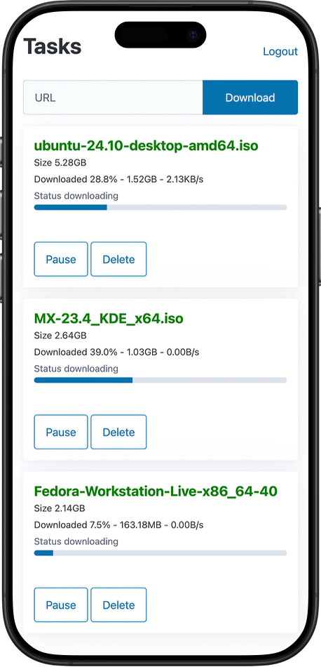

# Downtown

**A mobile-friendly web UI for [Synology Download Station](https://www.synology.com/en-us/dsm/packages/DownloadStation).**

[](https://github.com/lazydevorg/downtown/actions/workflows/go.yml)

[](./LICENSE)

Downtown is a small, fast front-end for Synology's Download Station, built
because the stock mobile experience is clunky. Add, monitor, pause, resume and
remove downloads from your phone — served as a single self-contained binary
with **zero third-party dependencies**.



## Features

- **Manage downloads** — add by URL/magnet, then pause, resume, or remove tasks.
- **Live task list** with human-readable sizes and progress.
- **Session-based login** against your Synology account.
- **Mobile-first**, server-rendered UI — fast, no client-side framework.
- **Single static binary** with templates embedded via `embed.FS`, or a tiny
  Docker image.

## How it works

Downtown is a thin, server-rendered proxy over the Download Station HTTP API.
The whole thing is standard-library Go:

- **`net/http`** with Go 1.22 method-based routing (`GET /tasks`,
  `POST /tasks`, `DELETE /tasks/{id}`, `PUT /tasks/{id}/pause`, …) behind a
  small authentication middleware.
- **`html/template`** views, **embedded into the binary** via `embed.FS` — no
  assets to ship alongside the executable.
- **`log/slog`** structured logging and sensible HTTP server timeouts.
- A small typed client that speaks to Download Station and manages the session.
- **No third-party dependencies** — the entire `go.mod` is just the standard
  library.

## Build and run

```shell
# required: your Synology NAS host and Download Station port
export DOWNLOAD_STATION_HOST=127.0.0.1:5001

# optional: listen address (default :4000)
export ADDR=:4000

# optional: verbose debug logging
export DEV_MODE=true

go build ./cmd/downtown
./downtown
```

Then open <http://localhost:4000>.

## Docker

```shell
docker build -t downtown .
docker run -p 4000:4000 -e DOWNLOAD_STATION_HOST=192.168.1.10:5001 downtown
```

The multi-stage build runs the test suite, then produces a static
(`CGO_ENABLED=0`) binary on a minimal Alpine image.

## Configuration

| Variable                 | Required | Default  | Description                                  |
|--------------------------|----------|----------|----------------------------------------------|
| `DOWNLOAD_STATION_HOST`  | yes      | —        | Synology NAS `host:port` for Download Station |
| `ADDR`                   | no       | `:4000`  | Address the web server listens on            |
| `DEV_MODE`               | no       | `false`  | `true` enables debug-level logging           |

## Development

```shell
go test ./...        # run the test suite
gofmt -w ./cmd ./ui  # format
```

CI runs the tests on every push and pull request.

## License

[MIT](./LICENSE) © 2024–2026 Fabio Volpe.
